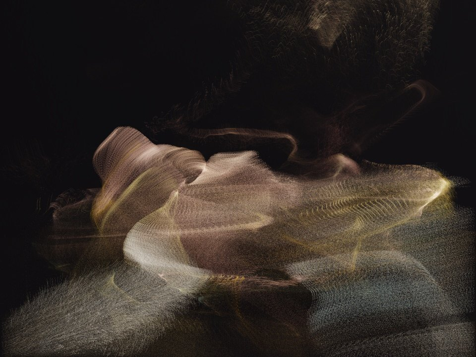
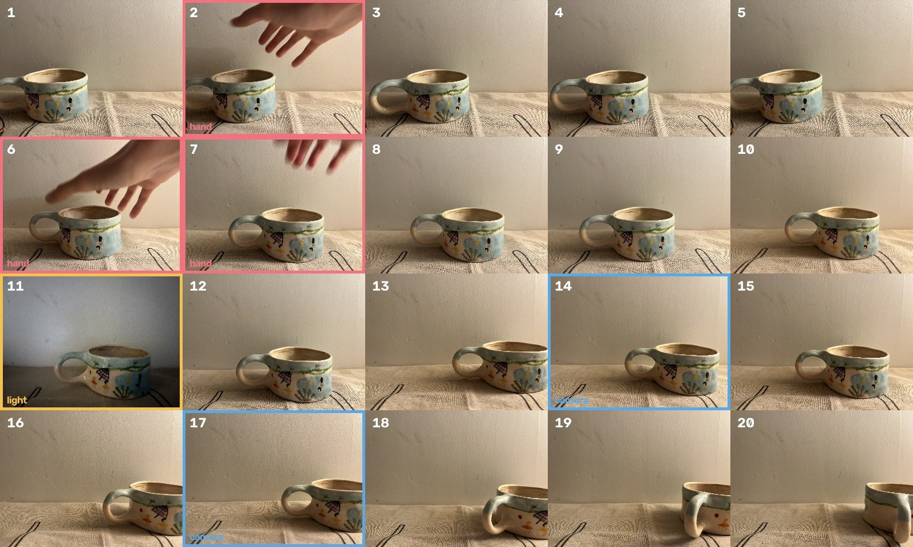
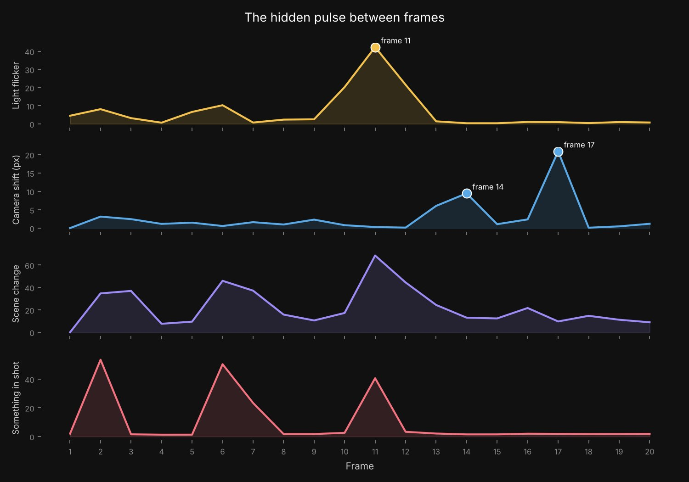
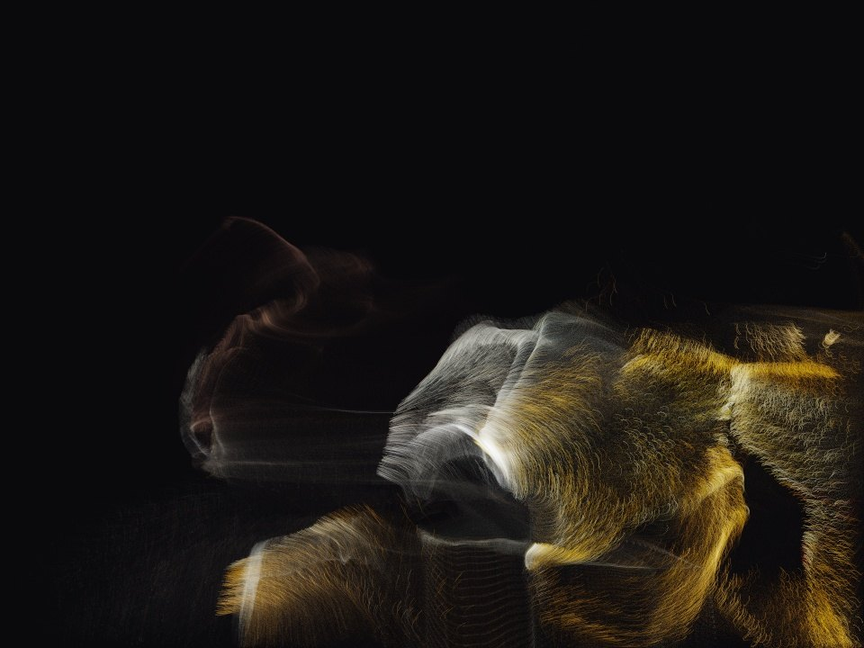

# Frame Pulse

> Can the hidden data between stop-motion frames become art, and also help animators find mistakes?

Every pair of stop-motion frames holds small changes in light, camera position and movement. Nobody looks at this data. Frame Pulse reads it in two ways:

- **As a tool**: it flags frames with mistakes, such as the animator's hand in the shot, a light flicker or a camera that moved.
- **As art**: the movement between frames releases thousands of light particles that take the colours of the scene.



## First test

A 20-frame stop-motion of my own hand-painted ceramic mug, shot on a phone. I made some mistakes on purpose.



| Frame | Flag | What happened | Planned? |
| --- | --- | --- | --- |
| 2, 6, 7 | hand | My hand entered the shot | Yes |
| 11 | light | The room light changed | Yes |
| 14, 17 | camera | The phone moved slightly | No, found by the method |

All planted mistakes were found, plus two camera shifts I did not plan. The camera signal is the least stable one: the phone was not on a tripod, so it moves a little in every frame, and small changes (even re-saving the images) can move which frames pass the threshold. A steadier setup and a better shift measure are part of the next steps.

Videos: [the stop-motion with flags](docs/stop_motion.mp4) · [the pulse sculpture](docs/pulse_sculpture.mp4)

## The hidden data



| Signal | How it is measured |
| --- | --- |
| Light flicker | Brightness of a frame compared with both neighbours |
| Camera shift | Shift of the background wall between frames (phase correlation) |
| Scene change | Pixel change between frames after brightness correction |
| Something in shot | Change in the wall area that appears in one frame and is gone in the next |

There is no training data. A robust z-score (median and MAD) marks what stands out. A mistake is something that appears in one frame and is gone in the next, so steady animation scores low.

## The art

`frame_pulse_art.py` computes dense optical flow (Farneback) between each pair of frames and removes the camera's own shake. Particles are released where something really moves, take the scene's colours, and are carried by the flow. Flagged frames release light in their signal's colour.



## Run it

```bash
pip install -r requirements.txt
python frame_pulse.py frames out          # analysis, charts, flagged frames
python frame_pulse_art.py frames out      # the pulse sculpture video
```

Put your own frames (in order, `.jpg`) in a folder and pass its name instead of `frames`.

## Next steps

1. More footage: longer shots, puppets and clay, and open stop-motion videos.
2. Compare detection methods (thresholds, Isolation Forest, autoencoders) with precision and recall.
3. Use optical flow for the direction of movement, not only how much.
4. A small user test: do people find mistakes faster with this visual than with a normal chart or list?

By İlayda Yılmaz, MSc Data Science, University of Greenwich, 2026. Footage and ceramic mug are my own.
